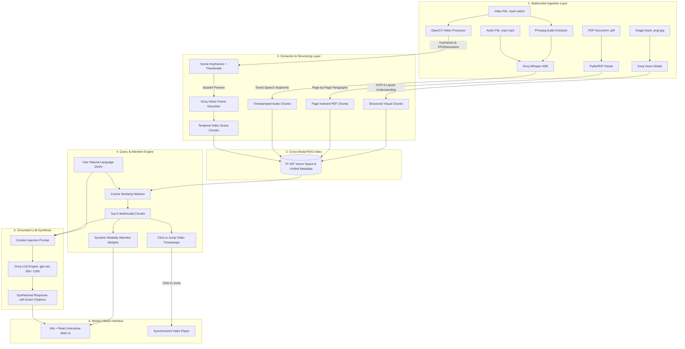

# 🎬 Multimodal Video RAG Engine

> An enterprise-grade, synchronized **Multimodal Retrieval-Augmented Generation (RAG)** platform designed for unified intelligence across **Video**, **Audio**, **PDF Documents**, and **Images**. Features sub-second retrieval, dynamic attention weighting, interactive click-to-jump temporal video playback, and Groq LLM synthesis.

---

## 📑 Table of Contents
1. [System Architecture](#-system-architecture)
2. [End-to-End Pipeline & How It Works](#-end-to-end-pipeline--how-it-works)
   - [1. Video Ingestion & Temporal Keyframing](#1-video-ingestion--temporal-keyframing)
   - [2. Audio Speech Recognition (ASR)](#2-audio-speech-recognition-asr)
   - [3. PDF Document Extraction & Chunking](#3-pdf-document-extraction--chunking)
   - [4. Image Visual Reasoning & OCR](#4-image-visual-reasoning--ocr)
   - [5. Cross-Modal Vector Index & Retrieval](#5-cross-modal-vector-index--retrieval)
   - [6. Dynamic Attention Weighting](#6-dynamic-attention-weighting)
   - [7. LLM Response Generation & Grounding](#7-llm-response-generation--grounding)
3. [Interactive Frontend Capabilities](#-interactive-frontend-capabilities)
4. [How to Run the Application](#-how-to-run-the-application)
   - [Prerequisites](#prerequisites)
   - [Backend Setup & Launch](#backend-setup--launch)
   - [Frontend Setup & Launch](#frontend-setup--launch)
5. [API Reference & Endpoints](#-api-reference--endpoints)
6. [Tech Stack](#-tech-stack)

---

## 🏗️ System Architecture



---

## ⚙️ End-to-End Pipeline & How It Works

The platform operates across four specialized extraction and indexing pipelines that coalesce into a single unified knowledge space:

### 1. Video Ingestion & Temporal Keyframing
- **Codec & Metadata Inspection**: Using OpenCV (`cv2.VideoCapture`), the video's frame count, frames-per-second (FPS), dimensions (e.g. 1920x1080), and duration are calculated.
- **Dynamic Checkpoint Sampling**: Depending on the video duration, strategic time intervals (e.g., 10%, 35%, 65%, 90% marks) are selected to sample keyframes.
- **Visual Thumbnail Generation**: Extracted frames are downscaled to 320x180 thumbnails, saved to `backend/uploads/keyframes/`, and made accessible via static HTTP URLs.
- **AI Frame Scene Description**: If Groq Vision is active, each keyframe is sent to `qwen/qwen3.8-27b` to generate a dynamic 2–4 word title and concise scene description.
- **Audio Track Extraction**: FFmpeg automatically pulls the PCM 16kHz mono audio track from the video and routes it directly to the Whisper transcription pipeline.

### 2. Audio Speech Recognition (ASR)
- **High-Speed Cloud Transcription**: Audio files (standalone or extracted from video) are sent to **Groq Whisper** (`whisper-large-v3-turbo`).
- **Granular Timestamp Synchronization**: The engine receives verbose JSON transcripts containing segmented timestamps `(s_start, s_end, text)`.
- **Temporal Alignment**: Spoken phrases are indexed with their exact second offsets, enabling the user to search for spoken phrases and click directly to that moment in the video.

### 3. PDF Document Extraction & Chunking
- **Deep Text & Page Parsing**: Using `PyMuPDF` (`fitz`), documents are parsed page-by-page.
- **Semantic Paragraph Splitting**: Text is split on structural boundaries into ~300-word chunks.
- **Page-Level Grounding**: Each chunk maintains metadata containing its source document name and exact page number (`Page 1`, `Page 2`, etc.), ensuring zero-hallucination citations.

### 4. Image Visual Reasoning & OCR
- **High-Resolution Inspection**: Images (system diagrams, UI mockups, financial graphs, receipts) are parsed using PIL to detect color mode, dimensions, and format.
- **Groq Vision Reasoning**: Using `qwen/qwen3.8-27b`, the visual asset is converted into detailed structured markdown (detecting headers, KPI metrics, architecture flowcharts, and tables).
- **Header-Level Granular Indexing**: The description is chunked by markdown section (`## `) so specific sub-components of diagrams can be retrieved with 100% precision.

---

### 5. Cross-Modal Vector Index & Retrieval
All four modalities populate a single `MultimodalRAGIndex`:

```python
{
    "id": "chunk_4",
    "text": "PDF 'financial_report.pdf' [Page 2]: Cloud spend reduced by 22%...",
    "modality": "pdf", # "video" | "audio" | "pdf" | "image"
    "metadata": {
        "filename": "financial_report.pdf",
        "page": 2,
        "label": "Page 2"
    }
}
```

- **Vectorization**: Uses scikit-learn's `TfidfVectorizer` with `ngram_range=(1, 2)`, sublinear term frequency scaling (`sublinear_tf=True`), and English stop-word removal.
- **Ultra-Fast Cosine Similarity**: Incoming user queries are transformed and matched against the sparse matrix in **< 5ms**, returning the top `k=6` most relevant cross-modal contexts.

---

### 6. Dynamic Attention Weighting
Unlike generic RAG that treats all chunks equally, this engine computes an active attention distribution across modalities:
1. Retrieval scores for each modality are accumulated:
   $$\text{Score}(m) = \sum_{c \in \text{TopChunks}, \text{mod}(c)=m} \text{score}(c)$$
2. Scores are normalized to percentage shares summing to 100%:
   $$\text{Weight}(m) = \text{round}\left(\frac{\text{Score}(m)}{\sum \text{Score}} \times 100\right)$$
3. The frontend displays these dynamic weights in real time (e.g. `Video: 56%`, `PDF: 31%`, `Image: 13%`, `Audio: 0%`).

---

### 7. LLM Response Generation & Grounding
- **Grounded System Prompting**: Top retrieved chunks are formatted with strict source headers:
  `[VIDEO CHUNK #1 | Timestamp: 00:35, File: overview.mp4]`
  `[PDF CHUNK #2 | Page: 2, File: report.pdf]`
- **Inference with Fallback**: Queries execute via Groq's high-speed LLM models (`openai/gpt-oss-20b` with automatic fallback to `openai/gpt-oss-120b`).
- **Strict Hallucination Prevention**: The system prompt strictly prohibits fabricating timestamps or claiming content not present in the retrieved chunks.
- **Interactive Timestamps**: The response JSON includes parsed timestamp bookmarks `[{"time": "00:35", "seconds": 35, "label": "Architecture Diagram"}]` that render as clickable buttons in the UI.

---

## 💻 Interactive Frontend Capabilities

- **Synchronized Video Player**: Built-in HTML5 video player with real-time time tracking and custom controls.
- **Click-to-Jump Video Bookmarks**: Clicking any timestamp badge in chat replies or keyframe cards immediately seeks the video player to that exact second and resumes playback.
- **Visual Keyframe Timeline**: Displays thumbnail cards for every detected scene with Groq Vision tags, titles, and timestamps.
- **Modality Attention Meters**: Visual progress bars show how much each data source contributed to the AI's answer.
- **Instant Demo Mode**: Pre-loaded with high-fidelity multimodal sample data (Video + PDF + Architecture Image) so users can test full-stack reasoning without uploading large files.
- **Theme Switcher**: Clean, modern dark mode and light mode aesthetics.

---

## 🚀 How to Run the Application

### Prerequisites
1. **Python 3.10+**
2. **Node.js 18+ & npm**
3. **FFmpeg** (Ensure `ffmpeg` is installed and in your system PATH)
4. **Groq API Key** (Obtain from [Groq Cloud Console](https://console.groq.com/))

---

### Backend Setup & Launch

1. Navigate to the backend directory:
   ```bash
   cd backend
   ```

2. Create and activate a Python virtual environment:
   ```powershell
   # Windows PowerShell
   python -m venv venv
   .\venv\Scripts\Activate.ps1

   # Linux / macOS
   python3 -m venv venv
   source venv/bin/activate
   ```

3. Install required packages:
   ```bash
   pip install -r requirements.txt
   ```

4. Configure your `.env` file inside `backend/.env`:
   ```env
   GROQ_API_KEY=gsk_your_groq_api_key_here
   ```

5. Start the FastAPI server:
   ```bash
   uvicorn main:app --host 0.0.0.0 --port 8000 --reload
   ```
   > Backend will run at: **http://localhost:8000**  
   > Interactive Swagger Docs: **http://localhost:8000/docs**

---

### Frontend Setup & Launch

1. Open a new terminal and navigate to the frontend directory:
   ```bash
   cd frontend
   ```

2. Install dependencies:
   ```bash
   npm install
   ```

3. Launch the Vite development server:
   ```bash
   npm run dev
   ```
   > Frontend will run at: **http://localhost:5173**

Open `http://localhost:5173` in your browser to interact with the application.

---

## 📡 API Reference & Endpoints

| Method | Endpoint | Description |
| :--- | :--- | :--- |
| `GET` | `/` | API status, active engine, and total indexed chunks |
| `GET` | `/status` | Server readiness, list of loaded files, and modality flags |
| `POST` | `/upload` | Multipart form endpoint accepting `video`, `pdf`, `audio`, `image` |
| `POST` | `/chat` | Main RAG conversation query endpoint |
| `POST` | `/demo` | Loads demo multimodal knowledge base |
| `POST` | `/clear` | Clears current session and resets vector index |
| `GET` | `/uploads/{path}` | Static file server for uploaded videos, images, and thumbnails |

### Sample Chat Request
```bash
curl -X POST http://localhost:8000/chat \
  -H "Content-Type: application/json" \
  -d '{"message": "What architecture was discussed at 00:35?"}'
```

### Sample Chat Response
```json
{
  "reply": "At 00:35, the presentation outlines the system architecture...",
  "sources": ["Video Timeline", "Visual Frame"],
  "timestamps": [
    {
      "time": "00:35",
      "seconds": 35,
      "label": "System Architecture & Vector DB"
    }
  ],
  "weights": {
    "video": 72,
    "pdf": 0,
    "audio": 0,
    "image": 28
  }
}
```

---

## 🛠️ Tech Stack

- **Backend Framework**: [FastAPI](https://fastapi.tiangolo.com/) + [Uvicorn](https://www.uvicorn.org/)
- **Computer Vision**: [OpenCV](https://opencv.org/) (`opencv-python-headless`) + [Pillow](https://python-pillow.org/)
- **Document Intelligence**: [PyMuPDF](https://pymupdf.readthedocs.io/) (`fitz`)
- **Audio Processing**: [FFmpeg](https://ffmpeg.org/) + Python `wave`
- **Vector Retrieval**: [scikit-learn](https://scikit-learn.org/) (TF-IDF Vectorizer + Cosine Similarity)
- **AI Models via Groq Cloud**:
  - LLM: `openai/gpt-oss-20b` / `openai/gpt-oss-120b`
  - Vision: `qwen/qwen3.8-27b`
  - Audio Transcription: `whisper-large-v3-turbo`
- **Frontend Stack**: [React 19](https://react.dev/), [TypeScript](https://www.typescriptlang.org/), [Vite](https://vitejs.dev/), [Tailwind CSS v4](https://tailwindcss.com/), [Lucide React](https://lucide.dev/), [React Markdown](https://github.com/remarkjs/react-markdown)
